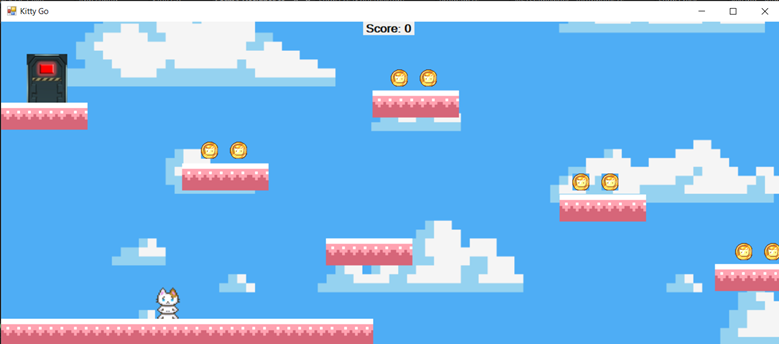
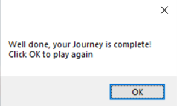
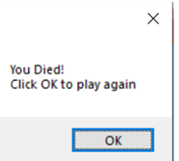

# 🐈 Kitty Go: Двумерный игровой движок платформера (C# / WPF)

Игра-платформер с боковой прокруткой и элементами бродилки, разработанная на языке программирования C# с использованием графической подсистемы Windows Presentation Foundation (WPF). Логика физики, гравитации, обработки ввода и коллизий объектов написана полностью вручную с нуля без использования готовых сторонних игровых движков (Unity/Unreal Engine).

## 🛠️ Технологии и компоненты

*   **Язык и среда:** C# + WPF (.NET Framework / .NET Core).
*   **Среда разработки:** Microsoft Visual Studio.
*   **Графический контент:** Многослойные спрайты и текстуры игрового мира (персонаж, платформы, монеты, ключ), отрисованные в Adobe Photoshop.

## 🕹️ Игровая механика и алгоритмы

Архитектура игры управляется центральным таймером синхронизации кадров (`MainTimerEvent`), который координирует следующие подсистемы:

1.  **Физика гравитации и прыжка:** Расчет векторов вертикального ускорения и сил падения (`jumpSpeed`, `force`) для имитации естественной физики прыжка.
2.  **Асинхронная обработка ввода:** Слушатели событий клавиатуры `KeyIsDown` и `KeyIsUp` для минимизации задержек управления персонажем (стрелки и пробел).
3.  **Обработка коллизий (Collision Engine):** Циклический перебор пересечений границ объектов на Canvas:
    *   `Platform` — Фиксация персонажа на поверхности платформы и сброс токена прыжка.
    *   `Coin` — Сбор монет, начисление очков в элемент `txtScore` и скрытие спрайта.
    *   `Key & Door` — Проверка логических условий: дверь откроется только при наличии собранного ключа и всех монет на уровне.

## 📸 Интерфейс приложения / Скриншоты

<b>Нажмите, чтобы открыть скриншоты (Click to expand)</b>

### 🗺️ Игровое поле и дизайн уровня

### 🏆 Окно успешного прохождения игры

### 💀 Окно окончания игры (Смерть персонажа)

---

## 💻 Локальный запуск проекта

1. Откройте Microsoft Visual Studio.
2. Загрузите решение через файл решения `KittyGo.sln`.
3. Нажмите клавишу `F5` (Сборка и запуск) для компиляции приложения в операционной системе Windows.
